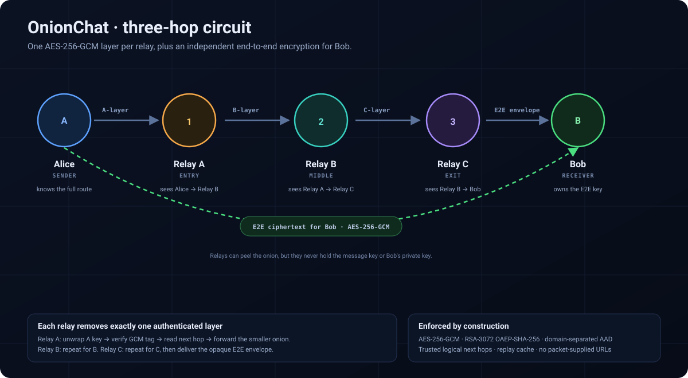
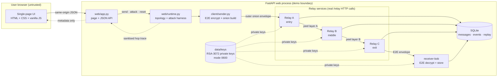
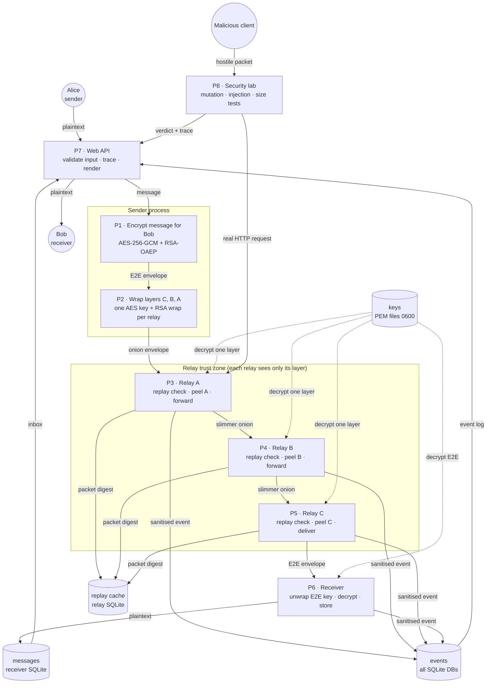
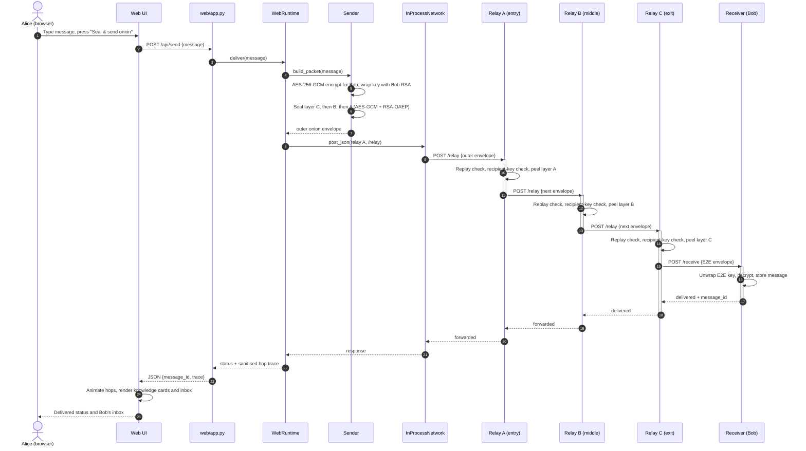

# OnionChat Architecture



## Components

```
                         (configured allowlists)
                                  │
Alice ──▶ Relay A (entry) ──▶ Relay B (middle) ──▶ Relay C (exit) ──▶ Bob
  │             │                    │                   │              │
  │             └─ peel A            └─ peel B           └─ peel C      │
  │                                                                     │
  └──────────────── end-to-end encrypted envelope ─────────────────────▶┘
```

| Component | Responsibility |
|---|---|
| `client/sender.py` | E2E-encrypts the message, builds the onion inside-out, POSTs to the entry relay, reports transport failure. |
| `relay/node.py` | FastAPI app for one relay role; exposes `/relay`, `/health`, `/status`; enforces the body limit. |
| `relay/router.py` | Replay check, recipient-key check, one-layer decryption, instruction validation, trusted forwarding or receiver delivery, event emission. |
| `relay/registry.py` | Static mapping of logical relay/receiver IDs to trusted endpoints. |
| `client/receiver.py` | FastAPI receiver; validates the E2E envelope, authenticates/decrypts it, stores the message, emits events. |
| `crypto/keys.py` | RSA-3072 generation, PEM import/export, secure private-key permissions. |
| `crypto/encryption.py` | AES-256-GCM, RSA-OAEP-SHA-256, domain-separated AAD, E2E envelope helpers. |
| `crypto/onion.py` | Layer sealing/peeling, instruction shapes, packet digest (ignores padding). |
| `crypto/keyring.py` | Per-service key rings: rotation, grace period, expiry, revocation. |
| `networking/traffic_policy.py` | Fixed-size cell padding and random mixing delays shared by sender and relays. |
| `adversary/traffic_analysis.py` | Simulated global passive observer with size and timing correlation attacks. |
| `web/static/js/onion-client.js` | Browser "Tor client": Web Crypto key generation, E2E encryption, onion construction, padding, decryption. |
| `web/chat.py` | Chat API: directory, registration, anonymous send, token-protected inbox, WebSocket push. |
| `client/mailbox.py` | Receiver for chat traffic: stores ciphertext per user and notifies connected browsers. |
| `storage/chat_store.py` | SQLite directory (public keys, hashed tokens) and encrypted mailboxes. |
| `evaluation/benchmarks.py` | Key-size, padding and mixing measurements written to `docs/results/`. |
| `networking/` | Strict Pydantic schemas, HTTPX transport, ASGI body-size middleware. |
| `storage/database.py` | SQLite messages, operational events and replay cache. |
| `observability/` | JSON logs and structured event persistence. |
| `config/settings.py` | Ports, endpoints, key IDs, limits, TTLs and paths. |
| `web/app.py` | FastAPI web application: Jinja2 page, JSON API, security headers, attack metadata. |
| `web/runtime.py` | Builds the four services in one process, auto-generates/loads keys, executes sends and attack experiments, exposes read-only status/keys/events views. |
| `web/trace.py` | Per-request `ContextVar` trace populated by optional relay/receiver observers. |
| `web/templates/`, `web/static/` | Responsive single-page UI with no build step, CDN or client framework. |
| `networking/inprocess.py` | Shared ASGI forwarder that dispatches trusted registry URLs to mounted apps for the demo and tests. |
| `main.py` | Key generation, individual service runners, `run-all`, `web`, `send`, `demo`, health/status/events. |

## System context

The web deployment wraps the same four services in one process while keeping
real HTTP request boundaries via `httpx.ASGITransport`. The CLI and Compose
deployments instead run each service as a separate process/container.



## Data-flow diagram



## Send sequence



Each relay's observer emits only metadata: service ID, role, stage, duration,
recipient key ID, next logical hop, packet byte count and error category. The
web layer never records plaintext, nonces, wrapped keys, ciphertext or private
keys.

## Two-way chat (browser-side cryptography)

The **Chat** tab is a real multi-user client. Unlike the Alice → Bob demo, all
secret operations happen in the user's browser (`web/static/js/onion-client.js`,
Web Crypto API), so the server is *untrusted for content*.

| Component | Knows | Never knows |
|---|---|---|
| Browser (sender) | Its own private key, the recipient, the message, the full path | Other users' private keys |
| Web server / `/api/chat/send` | That *some* packet arrived, its fixed size | Sender identity (no login on send), recipient, text |
| Relay A | Previous hop (the gateway), next hop (Relay B) | Recipient, text |
| Relay B | Relay A, Relay C | Sender, recipient, text |
| Relay C | Relay B, that the packet goes to the mailbox | Sender, text |
| Mailbox (`client/mailbox.py`) | Which user's key it is for, arrival time | Sender, text (stored as ciphertext) |
| Browser (recipient) | Text and the sender's *claimed* name | — |

```mermaid
sequenceDiagram
    autonumber
    actor A as Alice's browser
    participant S as Web server
    participant RA as Relay A
    participant RB as Relay B
    participant RC as Relay C
    participant M as Mailbox
    actor B as Bob's browser

    A->>S: GET /api/chat/directory
    S-->>A: relay + user public keys, cell size
    Note over A: encrypt for Bob (AES-256-GCM + RSA-OAEP)<br/>wrap layers C, B, A; pad to 18 432 B
    A->>S: POST /api/chat/send (opaque cell)
    S->>RA: forward unchanged
    RA->>RB: peel layer A, re-pad
    RB->>RC: peel layer B, re-pad
    RC->>M: peel layer C, deliver E2E ciphertext
    M->>M: store ciphertext in Bob's mailbox
    M-->>B: WebSocket: new mail (ciphertext)
    Note over B: decrypt with non-extractable private key
    B->>S: reply: same steps, encrypted to Alice's public key
```

Key handling in the browser:

- **Generation:** `crypto.subtle.generateKey` (RSA-OAEP 3072, SHA-256) with
  `extractable: false`; only the public key is exported (SPKI PEM).
- **Distribution:** the public key is registered in the directory
  (`POST /api/chat/register`); everyone fetches the directory before sending,
  which also picks up rotated relay keys.
- **Storage:** the private `CryptoKey` object is kept in IndexedDB. Because it
  is non-extractable, scripts can use it but cannot read or export it.
- **Revocation:** "Leave & forget my keys" deletes the private key; the
  mailbox token is per-tab and lives only in `sessionStorage`.

The browser code is checked against the Python implementation by
`tests/js/interop.mjs` (run from `tests/test_chat.py`): Node.js executes the
exact browser file, and the Python relays must peel its onions.

## Trust boundaries

1. **Sender → Relay A.** The sender knows the full circuit path and submits
   only the outermost onion envelope.
2. **Relay A → B → C.** Each relay learns the identity of the next relay from
   its decrypted layer but must resolve that identity through its local
   registry. Packet contents never contain URLs.
3. **Relay C → receiver.** Relay C learns a logical receiver ID and resolves it
   through the local registry; it forwards the E2E envelope without decrypting
   it.
4. **Receiver.** Only the receiver holds the private key capable of decrypting
   the E2E envelope. In the chat, that is the recipient's browser; the
   mailbox service stores ciphertext it cannot read.
5. **Browser → web API.** The browser is untrusted. The API validates message
   length, JSON shapes and attack identifiers, applies security headers and
   CORS-less same-origin defaults, and returns only sanitised metadata.
6. **Web runtime → services.** The hosted demo's ASGI transport is an internal
   trust boundary. Only URLs registered through the trusted registry can be
   reached, exactly as in the multi-process deployment.

The relay registry is a trusted configuration boundary. A compromised registry
or relay process can redirect traffic or observe metadata; onion routing does
not protect against a compromised endpoint in this educational model.

## Process and deployment model

- Each relay and the receiver is an independent FastAPI application.
- `python main.py run-relay --id ...` runs one service.
- `python main.py run-all` spawns the four local services as child processes.
- `python main.py demo` additionally sends the acceptance message and prints
  the stored receipt.
- `python main.py web` runs the interactive single-port demo. All four
  services are built in one process and connected through
  `networking/inprocess.py`; relays and receiver still exchange HTTP requests
  via `httpx.ASGITransport`, so processing code is identical to the
  multi-process deployment.
- Services communicate over HTTPX with explicit timeouts and no redirects.
- The default endpoints are localhost. The included `Dockerfile` and
  `docker-compose.yml` run each service in its own container with
  service-name registry endpoints supplied via environment variables.
  Configuration is centralized in `config/settings.py`.

## Persistence

Each service uses its own SQLite database under `data/db/`:

- `messages` (receiver): delivered plaintext messages, local to the receiver.
- `events` (all services): structured operational events.
- `replay_cache` (relays): relay-scoped packet digests with expiry.

SQLite is opened per operation with WAL mode and a busy timeout, keeping the
code safe for FastAPI's threadpool without sharing connections across threads.

## Observability

Every relay/receiver emits JSON log records and SQLite event rows for startup,
shutdown, packet receipt, validation/decryption success or failure, forwarding,
delivery, authentication failure, replay detection, health checks and internal
errors. Logs and events deliberately omit plaintext, private keys, AES session
keys, raw packets, client IPs and configured URLs.

The web layer adds an optional observer callback to each relay and the receiver.
For the duration of one request, `web/trace.py` captures a `ContextVar` trace
containing only the sanitised fields above. The UI uses that trace to animate
the circuit and build per-hop "what this hop can see" cards. The observer is
best-effort and cannot affect packet processing; production/CLI services leave
it disabled.
