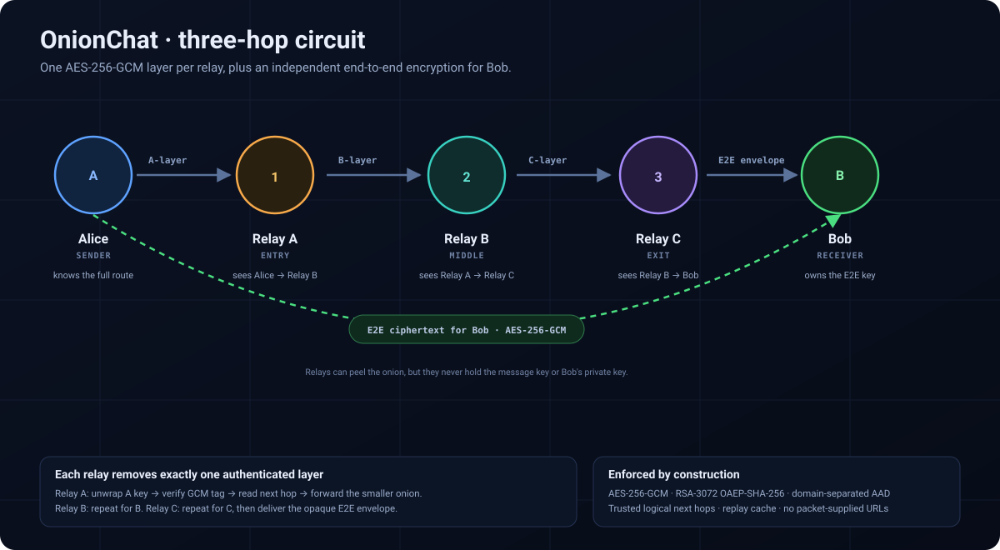

<!-- _class: lead -->

# OnionChat

## Private messaging through three relays

**Educational onion routing with real cryptography**

Alice → Relay A → Relay B → Relay C → Bob

---

## The problem

- A relay sees **who sent** a message and **who receives** it.
- Encrypting only the message leaves the **route and metadata** exposed.
- One compromised relay should not reveal the whole path.

**Goal:** separate *who you are* from *what you say*.

> Onion routing hides the message contents **and** gives each relay only a
> local view of the route.

---

## Scope and non-goals

**Built**

- Three-hop onion circuit with independent relays
- AES-256-GCM layers and RSA-OAEP key transport
- Independent end-to-end encryption for Bob
- Replay cache, trusted next-hop allowlists, input limits
- Interactive web demo, attack lab, sanitised observability

**Not built**

- Tor-level anonymity or censorship resistance
- Forward secrecy, cover traffic, fixed-size cells
- Sender authentication, accounts, production key management

---

## Architecture



```
Alice ──▶ Relay A (entry) ──▶ Relay B (middle) ──▶ Relay C (exit) ──▶ Bob
  │             │                    │                   │              │
  │             └─ peel A            └─ peel B           └─ peel C     │
  │                                                                     │
  └──────────────── end-to-end encrypted envelope ─────────────────────▶┘
```

- Each relay is a separate FastAPI service in the CLI/Compose deployment.
- The hosted demo runs all four in one process, but still exchanges real HTTP
  requests through `httpx.ASGITransport`.
- Packet data contains **logical IDs only**; a local registry resolves them.

---

## Packet construction

Alice builds the onion **inside-out**:

1. Encrypt the message for Bob with a fresh AES-256-GCM key.
2. Wrap that key with Bob's RSA public key.
3. Seal a layer for Relay C, then Relay B, then Relay A.

```
┌───────────────────────────── Relay A layer ─────────────────────────────┐
│ ┌───────────────────────── Relay B layer ─────────────────────────────┐ │
│ │ ┌───────────────────── Relay C layer ─────────────────────────────┐ │ │
│ │ │  E2E ciphertext for Bob + RSA-wrapped message key               │ │ │
│ │ └─────────────────────────────────────────────────────────────────┘ │ │
│ └─────────────────────────────────────────────────────────────────────┘ │
└─────────────────────────────────────────────────────────────────────────┘
```

Each relay removes **exactly one** layer and learns only its neighbour.

---

## Cryptographic choices

| Property | Primitive |
|---|---|
| Layer and message confidentiality | AES-256-GCM, 96-bit nonce, 128-bit tag |
| Key transport | RSA-3072 · OAEP-SHA-256 |
| Domain separation | AAD binds `onion`/`e2e`, version and recipient key ID |
| Replay resistance | Relay-local SHA-256 packet digest with TTL |
| Randomness | PyCryptodome CSPRNG |
| Key storage | PEM files, directory `0700`, files `0600` |

No custom primitives. Peer-reviewed library only (PyCryptodome).

**Known limit:** static RSA key transport gives **no forward secrecy**.

---

## Who learns what

| Participant | Can see | Cannot see |
|---|---|---|
| Alice | Route and plaintext before encryption | Whether Bob read it |
| Relay A | Alice → Relay B, packet size | Relay C, Bob, message |
| Relay B | Relay A → Relay C | Alice, Bob, message |
| Relay C | Relay B → Bob | Alice, earlier hops, message |
| Bob | Plaintext after E2E decryption | An authenticated sender identity |

The UI renders exactly this neighbour-only view from real relay events.

---

<!-- _class: lead -->

# Live demo

**`python main.py web`**

1. Send a message as Alice and watch the three hops.
2. Inspect what each hop observed.
3. Open the Security Lab and run the attacks.
4. Check Bob's inbox and the sanitised event log.

---

## Security lab: attacks are real

Each experiment sends a hostile packet through the real relay code and reports
the actual HTTP status.

| Experiment | Expected result | Control |
|---|---|---|
| Tamper ciphertext | 400 | GCM tag failure |
| Replay same packet | first 200, second 409 | Persistent replay cache |
| Wrong recipient key ID | 400 | Key-ID check before unwrap |
| Wrong layer/instruction | 400 | Role-specific instruction validation |
| URL in next-hop field | 400 | Trusted registry, no outbound request |
| Unregistered receiver | 400 | Registry lookup at exit relay |
| Oversized packet | 413 | ASGI body-size limit |

The verdict is derived from the response and hop trace, not a simulated check.

---

## Frontend design

- Four sections: **Circuit**, **Security lab**, **How it works**, **Keys & logs**
- Five-step guided tour on first visit; tooltips for crypto terms
- Live hop animation, shrinking-packet chart and per-hop knowledge cards
- Responsive layout, keyboard navigation, reduced-motion support
- Plain HTML/CSS/vanilla JS served locally — no CDN, build step or telemetry

**Security controls:** Jinja2 autoescaping, `textContent` only, no inline
scripts, strict CSP, `nosniff`, `DENY`, `no-store`, JSON-only API, sanitised
traces. Private keys are never served.

---

## Evidence

- **62 automated tests** pass (`pytest -q`).
- End-to-end delivery through all three relays is tested.
- No relay can decrypt the end-to-end plaintext.
- All seven attack experiments return the expected status.
- Web tests assert that plaintext, wrapped keys, ciphertext, nonces and PEM
  private keys never appear in traces, events or key metadata.
- Manual smoke test: page, send, attack and reset all work under Uvicorn.

Reproduce:

```bash
./.venv/bin/python -m pytest -q
python main.py web
```

---

## Trade-offs and lessons

- **Clarity over anonymity:** a fixed three-relay path is easy to teach, but
  lacks path selection, diversity and churn handling.
- **Metadata still leaks:** packet sizes shrink at each hop and timing is
  observable. Fixed-size cells and cover traffic are future work.
- **No forward secrecy:** long-term key compromise exposes recorded traffic.
- **One-process hosting:** free and simple; the protocol code is real, but
  process isolation does not apply.
- **Public demo controls:** reset and attack endpoints need authentication and
  rate limiting before any non-sandbox deployment.

Biggest lesson: making the crypto **visible** made the security properties and
their limits much easier to reason about.

---

<!-- _class: lead -->

# Questions?

**OnionChat**

- Sender: E2E encryption + inside-out onion construction
- Relays: one authenticated layer each, trusted next hops
- Receiver: E2E decryption + storage
- Web: guided visual demo, real attack lab, sanitised observability

Not Tor — a teaching system with honest boundaries.

<!-- Speaker notes: use demo-script.md for the timed live walkthrough. -->
